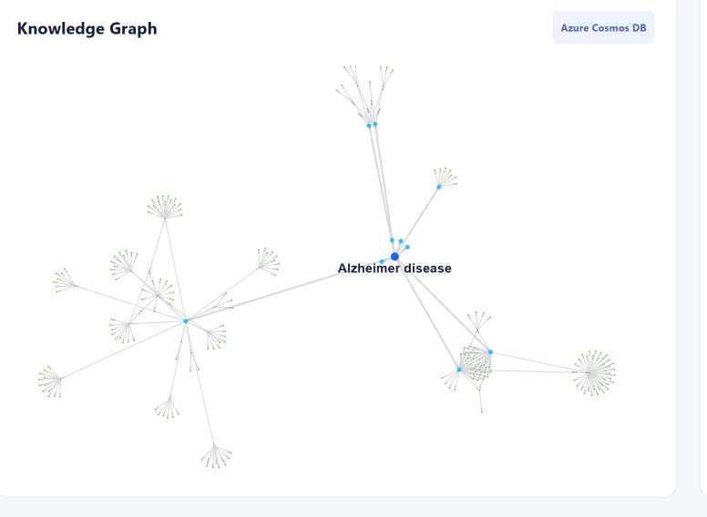

# DrugGraph AI

DrugGraph AI is a biomedical knowledge graph and retrieval-augmented generation
(RAG) application for exploring disease, target, drug, protein, and clinical
trial relationships. It combines an interactive React interface with a FastAPI
service, Azure Cosmos DB Gremlin graph retrieval, Open Targets-derived data,
and LLM-assisted explanations.

## Live project

- **Live frontend:** [DrugGraph AI on Azure Static Web Apps](https://red-pebble-06cc9b003.6.azurestaticapps.net)
- **Backend API:** [DrugGraph AI FastAPI service](https://druggraph-ai-api-spq-gpdnhydndmfrhsca.westeurope-01.azurewebsites.net)
- **Source code:** [spqdot/druggraph-ai](https://github.com/spqdot/druggraph-ai)

## Features

- Browse eight supported diseases from the active graph.
- Visualize disease, target, drug, protein, and clinical-trial nodes and
  relationships.
- Inspect selected graph nodes directly in the interface.
- Ask graph-grounded questions about targets, drugs, and clinical-trial
  availability for the selected disease.
- Receive clearly labeled general educational explanations for beginner
  biomedical questions.
- Handle unavailable graph data explicitly rather than inventing relationships.
- Use retry handling for transient Azure Cosmos DB Gremlin query failures.

## Screenshots

### Alzheimer disease knowledge graph



The force-directed visualization shows the Alzheimer disease node and the
currently loaded target, drug, protein, and clinical-trial relationship
structure from Azure Cosmos DB Gremlin.

## Architecture and data flow

```text
React + Vite frontend
        |
        | HTTPS requests
        v
FastAPI backend on Azure App Service
        |
        +--> Azure Cosmos DB Gremlin
        |      Disease --ASSOCIATED_WITH--> Target
        |      Target --HAS_PROTEIN--> Protein
        |      Target --TARGETED_BY--> Drug
        |      Drug --HAS_CLINICAL_TRIAL--> ClinicalTrial
        |
        +--> LLM response generation
                 |
                 v
          Graph-grounded or general educational answer
```

### Request flow

1. The frontend loads the disease list and selected disease graph from the
   FastAPI API.
2. The backend retrieves the selected disease's targets and related graph
   records from Azure Cosmos DB Gremlin.
3. For `/api/ask`, the backend builds an explicit disease-scoped context that
   records the retrieved relationships and any missing trial records.
4. The LLM returns an answer using that context for graph questions, or a
   provenance-labeled explanation for general educational questions.
5. The frontend displays the answer, API errors, graph statistics, and the
   force-directed graph visualization.

## Supported diseases and data coverage

The active graph contains **eight diseases**:

| Disease | Current coverage |
| --- | --- |
| Alzheimer disease | Target associations, drug relationships, and clinical-trial relationships |
| Parkinson disease | Target associations and drug relationships |
| Breast cancer | Target associations |
| Colorectal cancer | Target associations |
| Lung cancer | Target associations |
| Melanoma | Target associations |
| Rheumatoid arthritis | Target associations |
| Type 2 diabetes mellitus | Target associations |

Drug and clinical-trial relationships have not yet been loaded for the six
newly added diseases: breast cancer, colorectal cancer, lung cancer, melanoma,
rheumatoid arthritis, and type 2 diabetes mellitus. The application reports
that missing information is unavailable in the current graph; it does not
fabricate drug or trial relationships.

Open Targets is used by the repository's data-loading workflow for disease and
target associations. The running application reads the resulting graph from
Azure Cosmos DB Gremlin.

## RAG behavior

DrugGraph AI supports two answer modes:

### Graph-grounded biomedical questions

Questions such as the following are answered only from the selected disease's
retrieved Cosmos DB graph context:

- Which targets are associated with this disease?
- Which drugs are linked to this disease?
- What clinical trial information is available?
- What relationships connect a target and a drug?

If the relevant relationship is missing, the response says it is not available
in the current graph.

### General educational questions

Questions such as the following may use general biomedical knowledge:

- What is a biological target?
- What is a protein?
- What is a clinical trial?
- How are diseases, targets, and drugs related?

These answers begin with:

> General educational explanation (not retrieved from Cosmos DB):

This distinguishes educational content from data retrieved from the knowledge
graph.

## Technology stack

| Area | Technology |
| --- | --- |
| Frontend | React, Vite, react-force-graph-2d |
| Backend | Python, FastAPI, Uvicorn |
| Graph database | Azure Cosmos DB Gremlin |
| Biomedical data workflow | Open Targets |
| RAG answer generation | OpenAI Python SDK |
| Cloud hosting | Azure App Service and Azure Static Web Apps |
| CI/CD | GitHub Actions |

## Local setup

### Prerequisites

- Python 3.12, matching the Azure App Service runtime
- Node.js and npm
- Access to a Cosmos DB Gremlin graph and an OpenAI API key

### Backend

From the repository root:

```powershell
python -m venv .venv
.\.venv\Scripts\Activate.ps1
pip install -r requirements.txt
uvicorn app.main:app --reload
```

The development API is available at `http://127.0.0.1:8000`.

### Frontend

In a second terminal:

```powershell
cd frontend
npm install
npm run dev
```

Vite prints the local URL after startup. To point a local frontend at a local
backend, create `frontend/.env.local` with:

```dotenv
VITE_API_BASE=<your-local-api-base-url>
```

The checked-in production configuration targets the deployed Azure backend.

## Environment variables

Create a root `.env` file for the backend. Use your own values; do not commit
this file or any credentials.

```dotenv
COSMOS_GREMLIN_ENDPOINT=<your-cosmos-gremlin-endpoint>
COSMOS_GREMLIN_PASSWORD=<your-cosmos-gremlin-primary-key>
COSMOS_DATABASE=<your-cosmos-database-name>
COSMOS_GRAPH=<your-cosmos-graph-name>
OPENAI_API_KEY=<your-openai-api-key>
```

The production frontend uses:

```dotenv
VITE_API_BASE=<your-production-api-base-url>
```

Only public frontend configuration belongs in Vite environment files. Never put
Cosmos keys or LLM credentials in a `VITE_` variable.

## API endpoints

The following endpoints are implemented in [app/main.py](app/main.py):

| Method | Endpoint | Description |
| --- | --- | --- |
| `GET` | `/` | API health message |
| `GET` | `/api/diseases` | List available diseases |
| `GET` | `/api/disease/{disease_id}` | Retrieve detailed graph knowledge for one disease |
| `GET` | `/api/disease/{disease_id}/drug/{drug_name}` | Retrieve knowledge for a named disease-linked drug |
| `GET` | `/api/graph/{disease_id}` | Retrieve graph nodes, links, and counts for visualization |
| `POST` | `/api/ask` | Generate a graph-grounded or educational answer |

Example `POST /api/ask` request:

```json
{
  "question": "Which biological targets are associated with this disease?",
  "disease_id": "MONDO_0004975"
}
```

`disease_id` defaults to `MONDO_0004975` when it is omitted. `drug_name` is an
optional request field for drug-specific retrieval.

## Azure deployment

### Backend

The FastAPI service is deployed to Azure App Service:

```text
https://druggraph-ai-api-spq-gpdnhydndmfrhsca.westeurope-01.azurewebsites.net
```

[master_druggraph-ai-api-spq.yml](.github/workflows/master_druggraph-ai-api-spq.yml)
builds the Python artifact and deploys it through `azure/webapps-deploy`.

### Frontend

The React/Vite application is deployed to Azure Static Web Apps:

```text
https://red-pebble-06cc9b003.6.azurestaticapps.net
```

[azure-static-web-apps-red-pebble-06cc9b003.yml](.github/workflows/azure-static-web-apps-red-pebble-06cc9b003.yml)
builds from `./frontend` and deploys the `dist` output directory.

The API CORS allowlist includes the production Static Web Apps origin and the
supported local Vite development origins.

## Limitations and future improvements

- Six diseases currently include target associations only; their drug and
  clinical-trial relationships remain to be loaded.
- Graph coverage is limited to the records currently available in Cosmos DB.
- The project does not currently include committed application screenshots.
- Future work could expand disease coverage, add richer graph filtering,
  improve relationship provenance in the UI, and add broader automated API and
  browser-level integration testing.

## Security notes

- Keep `.env` files, deployment credentials, Cosmos keys, and OpenAI API keys
  out of source control.
- Configure secrets through GitHub Actions and Azure application settings.
- The frontend communicates with the backend over HTTPS in production.
- The backend restricts CORS to configured frontend origins rather than
  allowing arbitrary origins.

## License

No license file is currently included in this repository. Do not assume
permission to reuse the project beyond the rights granted by its owner until a
license is added.
